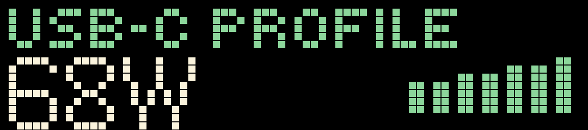
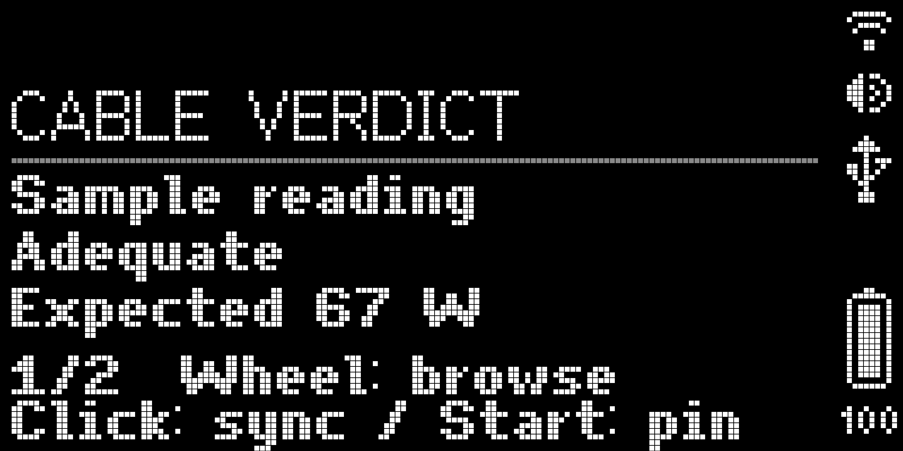

# Cable Verdict

Compare the negotiated Mac power adapter profile to your expected wattage and read battery charge.

Use the Mac’s reported power profile to compare two chargers or docks. Seeing the negotiated watts beside the battery percentage helps explain why a full battery can coexist with an unexpectedly low power profile.

## Screen transitions

Read one power path, then the next. The voltage and charging information follow the selection.



<details>

<summary>Watch the rear display</summary>



</details>

## Check a charger against its label

1. Set `expected_watts` to the rating you want to compare, then connect the Mac to the adapter or dock.
2. Read **USB-C PROFILE** on the front and the comparison on the rear. The recorded setup reported 68 W.
3. Turn the wheel to **MAC BATTERY**. The reading is independent of the negotiated wattage.


## Compare a second power path

1. Swap to the other adapter, cable or dock and let macOS finish negotiating.
2. Return to the profile page and click to refresh. Compare the reported profile under the same expected-wattage setting.
3. If macOS does not report a profile, the display uses `--`. A profile describes the connection; battery charge and actual power draw can vary separately.


## Example from the emulator

The example configuration expects 67 W. The front recording shows the profile supplied by this Mac, while the next page shows the battery charge reported by `pmset`. The recording used this Mac’s own I/O Registry and `pmset` readings.

## Set up the source

On a Mac laptop, choose the expected adapter wattage in the configuration. The bridge reads AppleSmartBattery from I/O Registry and battery percent from pmset. Watts refer to the adapter profile reported by macOS, not the instantaneous battery charging current. A disconnected or unreported adapter displays --. Browse to the second page for the battery.

## Connect the bar

Copy companion/example.json to a private config.json and adjust it for your source. From the project folder run `python3 companion/serve.py --config config.json`. Use Python 3.10+. Set Local companion URL to `http://127.0.0.1:8770/reading` on the emulator and allow local port 8770. On hardware, bind the companion to a trusted LAN interface and set its reachable address. The wheel browses pages. Click refreshes. Start pins or unpins the current page. The last good reading is labeled offline after a source error.

## Run in the emulator

Open BUSY Bar Emulator. From this repository, run:

```sh
~/.busy-emulator/bin/busy-emulator dev --once
```

Press **Back** to exit.

The GIFs are excerpts from the emulator recording. Each LED occupies a 16 × 16 cell with a black border. The end frames pause for reading.

[Full recording](media/controls.mp4) · [Rear display](screenshots/back-1.png) · [Firmware test](EMULATOR-QA.md) · [MIT license](LICENSE)
